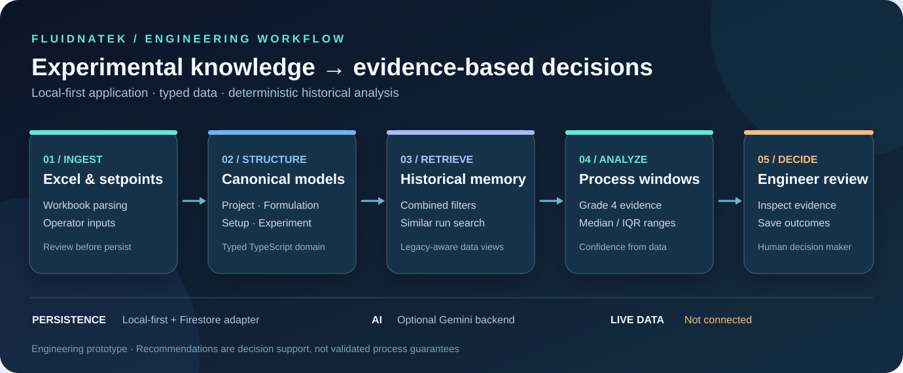

<div align="center">

# Fluidnatek LE-500 Smart Memory

**An industrial R&D software platform for structured electrospinning experiments, historical process intelligence and evidence-based engineering decisions.**

**React 19 · TypeScript · Vite · Node.js · Local-first persistence · Firestore adapter · Gemini API**

*Adaptive Excel ingestion · Typed process data · Deterministic similarity retrieval · Explainable parameter windows*

</div>



> **Engineering scope:** local-first experimental knowledge management and decision support. No live LE-500 telemetry, autonomous machine control or scientifically validated predictive ML model is claimed.

## Why this exists

Electrospinning teams accumulate process knowledge across spreadsheets, individual experiments and inconsistent material descriptions. **Smart Memory** brings projects, formulations, hardware setups and run outcomes into one typed workflow, allowing engineers to compare previous experiments before selecting parameters for another run.

This is an **engineering prototype / R&D decision-support tool**, not a validated machine controller or a fully deployed industrial SaaS.

## What it does

| Capability | Implementation |
|---|---|
| **Experimental records** | Organizes projects, raw materials, formulations, setups and process runs using typed domain models |
| **Historical search** | Combined filters across historical experiments, with explicit handling of missing legacy fields |
| **Similarity analysis** | Deterministic comparisons of relevant previous runs |
| **Evidence-based recommendations** | Derives parameter windows from similar **Grade 4** historical runs, using median and interquartile ranges (25th–75th percentiles); requires at least three sources by default |
| **Adaptive spreadsheet parsing** | Reads heterogeneous Excel workbooks, resolves fields and validates imported data; review is required before persistence |
| **Process setup** | Distinguishes hardware configuration from process setpoints, including separate **HV+** and **HV−** |
| **Persistence** | Local-first runtime, with typed repositories and an isolated Firestore adapter |
| **AI integration** | Optional Gemini-backed assistance; AI responses must be treated as suggestions, not validated manufacturing parameters |

## Product workflow

```text
Project → Formulation → Machine setup → Operator setpoints
                        ↓
              Search historical runs
                        ↓
          Similarity + Grade 4 evidence
                        ↓
          Median / IQR parameter windows
                        ↓
           Engineer review → Save run
```

The current **Live Telemetry & Smart Memory** view uses **operator-entered setpoints**. It does **not** stream measured values from an LE-500 or DataHub device.

## Technical architecture

```text
src/
├── application/       Use cases, orchestration, mappings
├── core/              Excel ingestion and domain logic
├── components/        React screens and interactive workflow
├── features/          Historical / experimental assistant logic
├── repositories/      Typed persistence boundaries
├── services/          Infrastructure integrations
├── lib/               Shared adapters and utilities
├── migrations/        Historical data migration tooling
└── types.ts           Application-facing types

server.ts              Node / Express backend, optional AI integration
```

**Import pipeline:** workbook extraction → semantic resolution → normalization → validation → confidence / review → canonical models.

**Recommendation logic:** similar experiment selection → Grade 4 evidence → median and 25th–75th percentile parameter windows → evidence and confidence shown to the operator.

A clear boundary separates **measured data**, **manual setpoints**, **historical evidence** and **AI suggestions**. No machine-telemetry integration or closed-loop parameter control is claimed.

## Screenshots

The diagram above depicts the verified software architecture. **Actual application screenshots will be added from the running React build** after review for confidential laboratory data. This README deliberately does not present Google AI Studio, mockups or stock dashboards as real product screenshots.

## Run locally

**Requirements:** Node.js 20+, npm. An `.env` is needed only for integrations enabled in your environment.

```bash
git clone https://github.com/gabrieledellamalva06-coding/fluidnatek-le-500-smart-memory-project.git
cd fluidnatek-le-500-smart-memory-project
npm ci
cp .env.example .env
npm run dev
```

Open the URL displayed by the development server. The example environment file documents available configuration variables. **Never commit production keys, laboratory identifiers or customer records.**

**Verification**

```bash
npm run lint
npm test
npm run build
```

## Current boundaries

- Spreadsheet parsing and validation exist, but the import UI does **not** automatically commit arbitrary Excel rows to Firestore.
- Local-first storage and historical records are available; Firestore is an isolated adapter, not a compulsory online runtime.
- Historical filtering is currently in-memory and is not intended as an unlimited-scale query engine.
- No real-time machine signals, DataHub connection, automatic parameter control or scientifically validated predictive ML model are claimed.
- Production-grade organization isolation, authorization and audit controls need further engineering before enterprise use.

See [implementation status](docs/IMPLEMENTATION_STATUS.md) for the detailed implementation and limitations, [operator guide](docs/USER_GUIDE.md) for the workflow, and [roadmap](ROADMAP.md) for future work.

## Collaboration and provenance

The commit history includes work attributed to **Dilara Badur** as well as the repository owner. GitHub's automatic Contributors panel depends on commits being associated with verified GitHub accounts; access as a repository collaborator alone does not grant contributor attribution.

Additional contributor credits should be added only with confirmed identities and consent. Please refer to the Git history for code-level attribution.

## Ownership

Project-specific code, industrial data and branding may be subject to separate stakeholder agreements. Public visibility of this repository does **not** imply permission to reuse confidential process data or trademarks. Review relevant ownership and licensing terms before redistribution.
